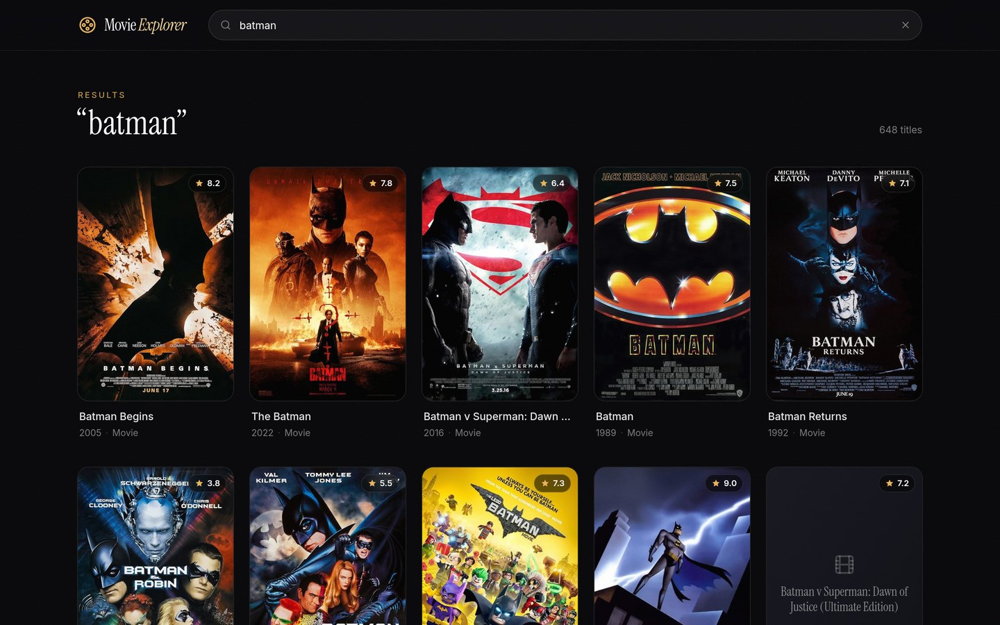
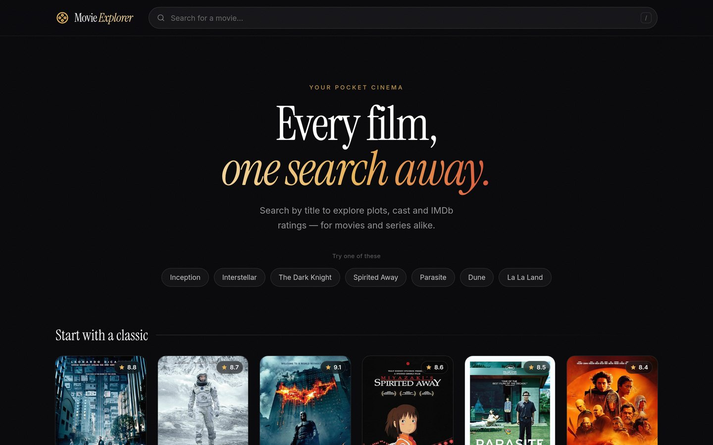
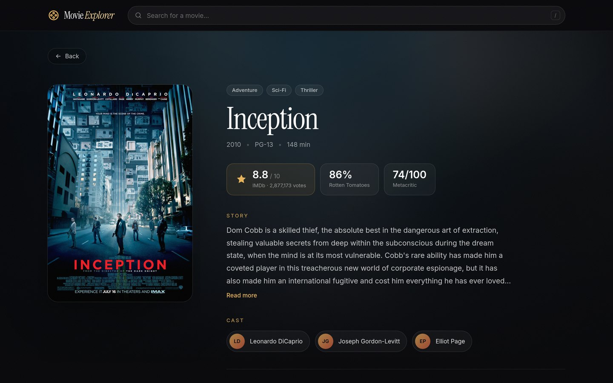
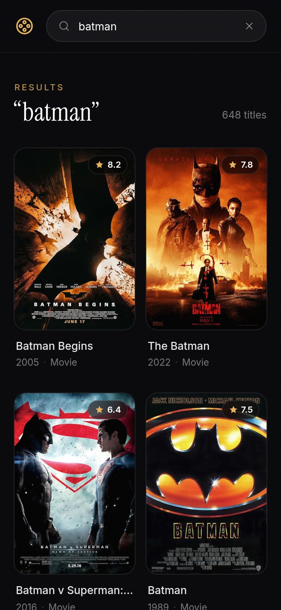
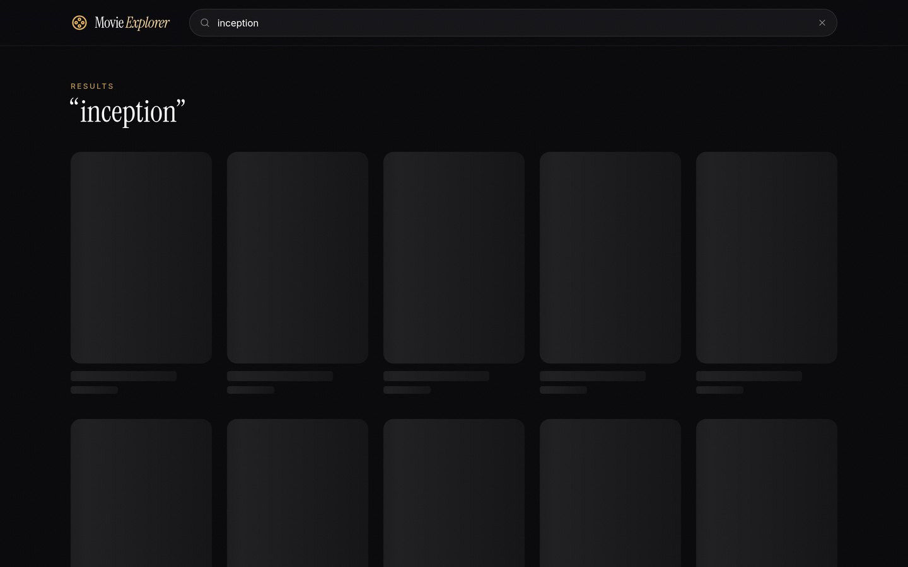
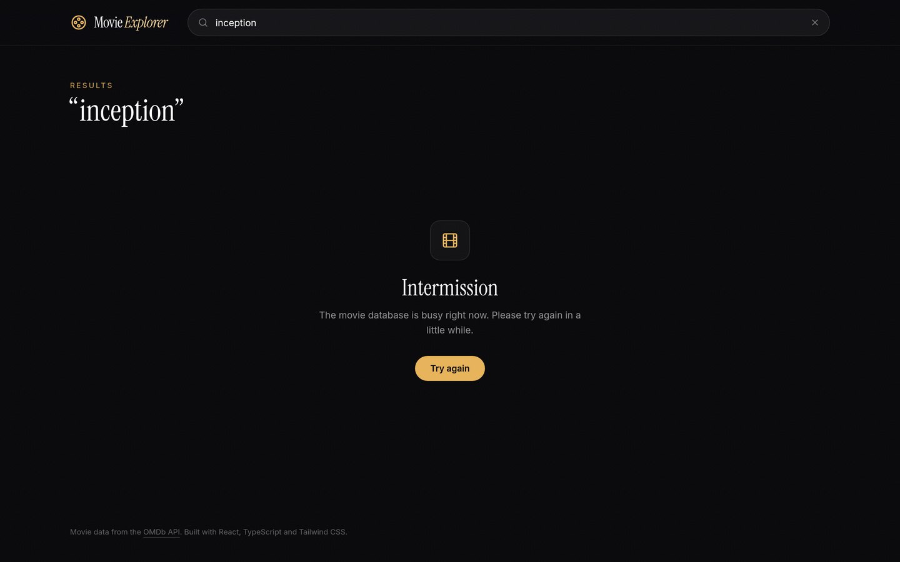
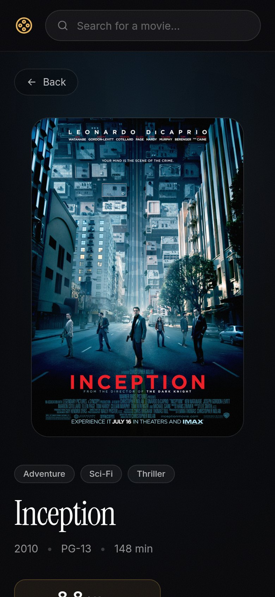

# Movie Explorer

A cinematic movie search app built with **React, TypeScript and Tailwind CSS**. Search any film or series, browse results in a responsive poster grid with IMDb ratings, and open a details page with the plot, cast, credits and ratings, all on a dark, film-inspired interface.

Movie data comes from the [OMDb API](https://www.omdbapi.com/) through a small serverless proxy that keeps the API keys secret, caches answers, and switches keys automatically if one hits its daily limit.

**Live demo:** [movie-explorer-starlin.vercel.app](https://movie-explorer-starlin.vercel.app)



## Features

- **Instant search**: debounced as you type, with the query synced to the URL (`/?q=inception`), so results can be shared, refreshed and restored with the Back button
- **Poster grid**: responsive (2 → 5 columns), with IMDb rating badges, hover lift and glow, and staggered fade-in
- **Details page** (`/movie/:id`): large poster over a blurred backdrop made from the poster, genres, runtime, IMDb, Rotten Tomatoes and Metacritic scores, plot with "Read more", cast and credits
- **Every state designed**: welcome screen with suggested titles and a live "Start with a classic" shelf, shimmer skeletons while loading, a friendly "No matches" screen, and an error screen with **Try again**
- **Keyboard friendly**: press `/` to jump to search, `Esc` to clear it, visible focus rings, and every card is a real link
- **Responsive**: designed for a small iPhone screen up to a wide laptop; respects "reduce motion"
- **Secure API access**: the browser never sees an API key

| Home | Details | Phone |
| --- | --- | --- |
|  |  |  |

| Loading | Error | Phone details |
| --- | --- | --- |
|  |  |  |

## Tech stack

| Area | Choice |
| --- | --- |
| UI | React 18, TypeScript (strict) |
| Styling | Tailwind CSS v4 with custom theme tokens, Instrument Serif + Inter |
| Routing | React Router (data router, scroll restoration) |
| Build | Vite |
| API | OMDb via a Vercel serverless function (`api/omdb.ts`) |
| Quality | Vitest + Testing Library, ESLint, Prettier |

## Architecture

```
 Browser (React app)
   │  GET /api/omdb?s=batman&page=1        no API key in the browser
   ▼
 Vercel edge cache  ── HIT ──▶ answer straight from the CDN (no function call)
   │ MISS
   ▼
 api/omdb.ts  (serverless function)
   ├─ in-memory LRU cache  ── HIT ──▶ answer
   ├─ key 1 ──▶ OMDb   "Request limit reached!" → bench key 1
   ├─ key 2 ──▶ OMDb   ✓
   └─ all keys exhausted → clean 503 JSON → friendly error screen
```

During development, `vite.config.ts` mounts the same proxy code as dev-server middleware, so `npm run dev` works without the Vercel CLI.

```
src/
  api/          omdb.ts (typed client, errors, caching), types.ts
  hooks/        useMovieSearch, useAsync, useRating, useDebouncedValue
  components/   Header, SearchBar, MovieCard, Poster, MovieGrid, FeaturedPicks, StateMessage
  pages/        SearchPage, MoviePage, NotFoundPage
  lib/          limit.ts (concurrency limiter), poster.ts (poster sizes)
api/
  omdb.ts       Vercel function
  _lib/         omdbProxy.ts (key rotation + caching), lru.ts
```

## Getting started

1. Get a free OMDb key at [omdbapi.com/apikey.aspx](https://www.omdbapi.com/apikey.aspx) (one is enough; add more for higher traffic).
2. Install and configure:

   ```bash
   npm install
   cp .env.example .env
   # then edit .env:
   # OMDB_API_KEYS=yourkey1,yourkey2
   ```

3. Run it:

   ```bash
   npm run dev       # http://localhost:5173
   npm test          # unit tests
   npm run build     # type-check + production build
   ```

### Deploying to Vercel

Import the repo in Vercel (framework preset: Vite) and add an environment variable `OMDB_API_KEYS` with your comma-separated keys. `api/omdb.ts` becomes the serverless function automatically, and `vercel.json` sends every other route to the React app so deep links like `/movie/tt1375666` work.

## Design & techniques

**API proxy that hides the keys.** In a normal React app any key in the code ships to the browser and anyone can copy it from the browser's developer tools. Here the app only ever calls `/api/omdb`. The serverless function adds the key on the server, and it only forwards a whitelist of parameters (`s`, `i`, `page`, `type`, `y`, `plot`), so the proxy can't be abused as an open relay.

**Edge caching.** Successful answers are sent with `Cache-Control: public, s-maxage=86400, stale-while-revalidate=604800`. Vercel's CDN keeps them for a day and keeps serving the old copy for a week while it refreshes in the background. If 100 people search "Batman", OMDb sees about one request. "Not found" answers are cached for an hour; errors are never cached.

**Key fallback.** `OMDB_API_KEYS` holds one or more keys. The proxy tries them in order. When OMDb answers `Request limit reached!` (or says a key is invalid), that key is benched for a while and the next key is used. If every key is exhausted the user gets a clean `503` with a readable message instead of a crash.

**Three layers of caching.** CDN cache, a small LRU cache (with expiry) inside the function, and an in-memory + `sessionStorage` cache in the browser. Going back from a movie to the results costs zero network requests, and the list renders instantly, so scroll restoration lands exactly where you were.

**Debounced search.** `useDebouncedValue` waits 350 ms after the last keystroke before searching, so typing "interstellar" makes one request instead of twelve.

**Cancelling stale requests.** Each search creates an `AbortController` and aborts the previous one. A slow answer for "bat" can never overwrite the newer answer for "batman".

**URL as the source of truth.** The query lives in `?q=` and the movie in `/movie/:id`. That makes searches shareable and refresh-safe, and lets the browser's Back button do the work instead of custom state.

**Ratings without N+1 chaos.** OMDb search results don't include ratings, so each card fetches its movie's details through a tiny concurrency limiter (`lib/limit.ts`, max 4 in flight). The answers are cached, so opening a movie after seeing its card is instant.

**Perceived performance.** Shimmer skeletons match the real layout, so nothing jumps when data arrives. Posters fade in once loaded, and the app requests a sharper poster size for the details page by rewriting the image URL's size suffix (`lib/poster.ts`). If a poster is missing it falls back to a styled placeholder.

**Cinematic visual design.** A near-black palette with warm gold accents, an editorial serif (Instrument Serif) for headings paired with Inter for UI text, a blurred, colour-saturated copy of the poster as the details backdrop, ambient light glows, a subtle film-grain overlay, and a frosted-glass sticky header (`backdrop-filter`). Motion is short and eased, and is turned off when the user prefers reduced motion.

**Typed, testable core.** The API client maps every failure to a typed `OmdbError` (`not-found`, `unavailable`, `network`, …) so the UI can show the right screen. The proxy logic is a pure function with an injectable `fetch`, which makes key rotation and caching easy to unit test.

## Tests

```bash
npm test
```

Covers the proxy's key rotation (fallback, benching, all keys exhausted), caching and parameter whitelisting, the LRU cache's eviction and expiry, the API client's error mapping and caching, the concurrency limiter, the debounce hook, and poster URL handling.

## License

MIT
